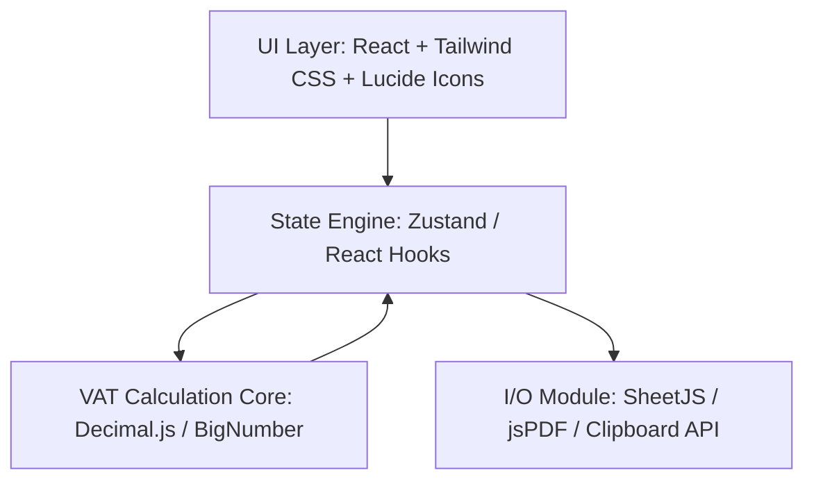

# 정밀 부가가치세 계산기 (VAT Calculator) 설계 및 개발 계획안

## 1. 개요 및 목표
단순한 10% 산출을 넘어 대한민국 세법(부가가치세법 및 국세징수법)의 단수처리 규정, 품목별 단수오차 보정, 실무상의 다양한 특수/예외 거래 유형을 완벽하게 처리하는 **엔터프라이즈급 정밀 부가세 계산 엔진 및 사용자 인터페이스**를 구축합니다.

---

## 2. 정밀 계산 로직 및 세무 요구사항

### 2.1 양방향 정밀 산출
- **정방향 계산**: 공급가액(기본값) 입력 → 부가세액(10%) 산출 → 합계금액(공급대가) 도출
- **역방향 계산(역산)**: 합계금액(공급대가) 입력 → 공급가액(\(\times \frac{10}{11}\)) 및 세액(\(\times \frac{1}{11}\)) 분리
- **세액 기준 역산**: 부가세액 입력 → 공급가액 및 합계금액 도출

### 2.2 단수처리(Rounding) 및 오차 보정 옵션
1. **국세징수법 제74조(원단위 절사)**: 국세 산출 시 10원 미만 금액(1원 단위) 절사 원칙
2. **거래 관행별 세액 처리 방식**:
   - **반올림 (Round Half-Up)**: 일반적인 전자세금계산서 발행 시스템 표준
   - **절사 (Floor)**: 보수적 세무 처리
   - **올림 (Ceil)**
3. **품목별 합산 vs 합계 일괄 산출 오차(Penny Problem) 조정**:
   - 다품목 거래 시 [품목별 부가세의 합]과 [전체 공급가액의 합 \(\times 10\%\)] 사이에서 발생하는 1~9원 단수 차이를 선택된 정책(최종 품목에 가감 또는 별도 보정 항목 표기)으로 해결

### 2.3 과세 및 업종 유형 지원
| 구분 | 부가세율 / 산출 방식 | 비고 |
| :--- | :--- | :--- |
| **일반과세** | 10% | 공급가액 \(\times 0.1\) |
| **영세율** | 0% | 수출, 외화획득 용역 등 (세금계산서 발급) |
| **면세** | 비과세 (세액 0원) | 농수산물, 의료, 교육 등 (계산서 발급 대상) |
| **간이과세** | 업종별 부가가치율 (15% ~ 40%) \(\times 10\%\) | 소상공인/간이과세자 신고용 참고 산출 |
| **복합과세 / 봉사료** | 과세분 + 비과세분(봉사료) 분리 | 호텔/외식업 등 봉사료 분리 기재 |

---

## 3. 실무 특수/예외 상황 처리 규정 (추가 보강)

실제 회계 및 세무 실무에서 자주 문제가 되는 다음 예외 케이스들을 기본 로직에 포함합니다:

### 3.1 마이너스(음수) 수정세금계산서 및 환불/반품
- 반품, 에누리, 공급가액 증감으로 인한 마이너스 세금계산서 발행 지원
- 음수 금액에 대한 단수처리 일관성 유지 (절댓값 기준 반올림 후 부호 적용: Round Half Away from Zero)

### 3.2 할인(에누리) 및 쿠폰/포인트 처리 순서
- **매출에누리/할인**: 공급가액 산정 전 차감 후 세액 계산 (과세표준 제외 원칙)
- **사후 장려금/포인트 결제**: 과세표준 포함 여부 옵션 제공 (실제 공급가액 유지 vs 차감)

### 3.3 외화 환산 거래 (수출 및 크로스보더)
- 외화 금액(USD, JPY 등) 및 기준환율(매매기준율) 입력 지원
- **환산 순서별 단수오차 방지**: [외화 \(\times\) 환율] 원화 환산 단계에서의 소수점 절사 규칙 명확화

### 3.4 복합 결제 (과세 + 면세 품목 동시 거래)
- 마트, 식당, 도소매 등에서 과세품목과 면세품목(농축수산물 등)을 한 번에 결제할 때 과세/면세 분리 산출
- 과세 공급가액 / 면세 공급가액 / 부가세액 / 총 공급대가 4단계 완전 분리 명세

### 3.5 매입세액 불공제 항목 플래그
- 지출 증빙 검토 시 부가세가 영수증에 포함되어 있으나 매입세액 공제를 받을 수 없는 항목(비영업용 승용차, 접대비, 면세사업 관련 등) 체크박스 제공 (합계금액 전액을 비용/원가로 산입 처리 지원)

---

## 4. 핵심 기능 목록

1. **단일/다중 품목 테이블 모드**:
   - 단일 건 즉시 계산기
   - 엑셀형 다중 품목 거래명세서/세금계산서 모드 (수량, 단가, 할인, 공급가액, 세액, 비고)
2. **세금계산서 / 영수증 실시간 프리뷰**:
   - 전자세금계산서 표준 양식 뷰어
   - 클립보드 복사 (텍스트 및 서식 있는 HTML)
   - PDF 출력 및 인쇄 최적화
3. **데이터 입출력 및 히스토리**:
   - 엑셀/CSV 일괄 업로드 및 자동 계산
   - 계산 결과 엑셀(XLSX), CSV 다운로드
   - 최근 계산 기록(로컬 스토리지 기반 히스토리)
4. **숫자 편의 기능**:
   - 실시간 한글 금액 표기 (예: 1,234,500원 → 일백이십삼만사천오백 원)
   - 만/억 단위 빠른 입력 버튼 (+1만, +10만, +100만, +1,000만)

---

## 5. 시스템 아키텍처 및 기술 스택 제안

- **Runtime / Framework**: Vite + React 19 (TypeScript)
- **정밀 연산 라이브러리**: `decimal.js` 또는 `bignumber.js` (부동소수점 오차 원천 차단)
- **스타일링 / 컴포넌트**: Tailwind CSS + Lucide React
- **내보내기 / 파싱**: `xlsx`(SheetJS), `jspdf`

---

## 6. 단계별 개발 계획 (Roadmap)

### Phase 1: 기반 구축 및 정밀 연산 엔진 구현
- Vite + TypeScript + Tailwind 환경 세팅
- `vat-core`: 정밀 부가세 연산 모듈 구현
  - 양방향 산출 (공급가액 ↔ 부가세액 ↔ 공급대가)
  - 단수처리(반올림, 절사, 올림, 10원 미만 국세법 절사)
  - 마이너스(환불), 할인/에누리, 품목 간 1원 단수오차 보정 알고리즘
  - 단위 테스트(Vitest)로 국세청 기준 데이터 검증

### Phase 2: 단일 품목 계산 인터페이스 구현
- 직관적인 숫자 입력 패드 (실시간 천 단위 콤마, 빠른 단위 버튼)
- 실시간 한글 금액 변환 툴팁
- 과세/영세/면세/간이/봉사료/불공제 모드 전환 스위치
- 계산 결과 요약 카드 및 1초 원클릭 복사 기능

### Phase 3: 다중 품목 및 세금계산서 작성 모드
- 스프레드시트 형태 품목 그리드 (품목명, 규격, 수량, 단가, 할인율, 공급가액, 세액)
- 과세/면세 혼합 품목 자동 분리 집계
- 표준 세금계산서 형태 실시간 렌더링 컴포넌트

### Phase 4: 입출력 확장 및 검증
- CSV / Excel 가져오기 및 내보내기 구현
- 세금계산서 양식 인쇄 및 PDF 저장
- 국세청 홈택스 모의 데이터 및 실제 영수증 샘플을 통한 정합성 교차 검증
